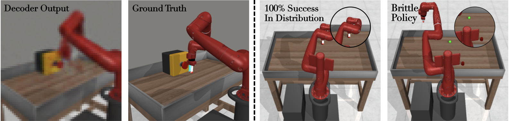
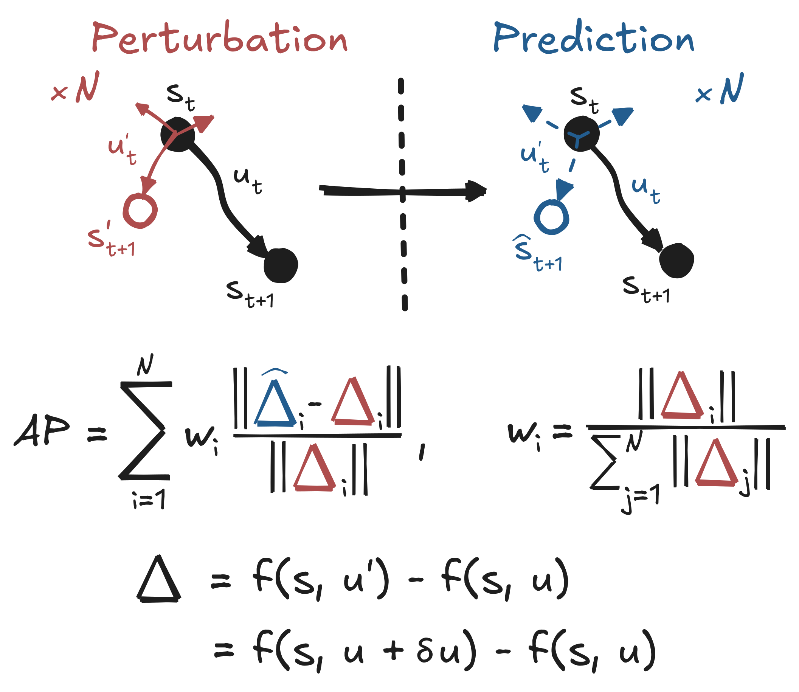
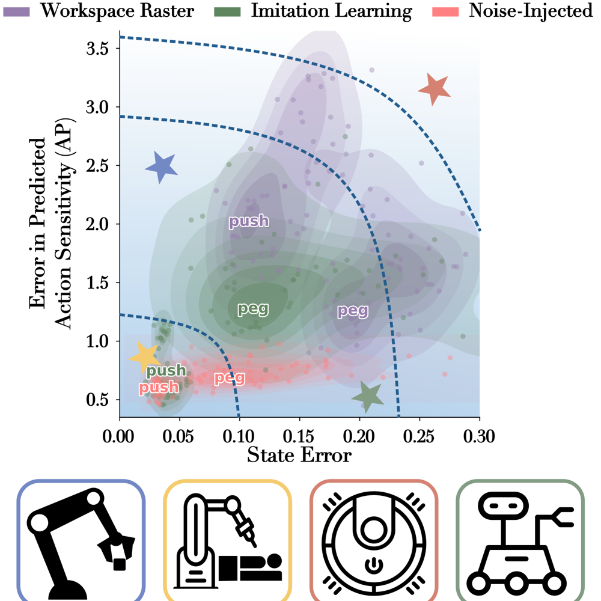

<!-- TODO(ayush): add arXiv/OpenReview link -->

TLDR: 

Do metrics actually measure the intended benefit of world models? World models provide decision transparency by predicting dynamics without physical rollouts. We need new metrics that evaluate counterfactual predictive accuracy in order to have reliable auditors of end-to-end learning systems.

Motivation:

Current world model metrics do not isolate the utility of the dynamics predictor. A world model can have blurry, low-quality reconstructions and still be a great planner. A policy can succeed 100% of the time in distribution and still fall apart the moment it leaves its training data. Neither of those tells you whether the model gets the <em>consequences of an action</em> right, which is the whole reason to have a world model in the first place.

Overview:

An end-to-end learning system is a stack of components: perception, dynamics, a planner, and a reward. Each one already has its go-to metric: reconstruction accuracy for perception, prediction error for dynamics, and task performance for the planner and reward. But those metrics overlook the unique benefit of world models: the fidelity of action-conditioned dynamics. Action sensitivity analysis can audit dynamics prediction, which would otherwise be impossible without physical rollouts.

Methodology:

Similar to classic input-output dynamic models, world model fidelity can be measured with standard sensitivity analysis: impulse responses in the action space. The Action Perturbation (AP) metric nudges the nominal controls, then compares how much the world model <em>thinks</em> the outcome changed against how much it <em>actually</em> changed in the environment, over a horizon.
  
A score of 0 is perfect, and a score of 1 is what you get from a model that ignores the action entirely, so anything above 1 is worse than ignoring it. Because it's a difference of differences, a constant bias in the predicted state cancels out, which makes it a different question from state error.

To test it, we froze a released TD-MPC2 model and retrained only the dynamics head on 100k interactions from three data regimes: a workspace raster, imitation learning, and imitation learning with injected noise. We evaluated on two Meta-World tasks, Push and Peg insertion.

Results:

State error and AP disagree. The imitation learning and noise-injected heads have similar state error, but the noise-injected head is about 16% (Push) and 48% (Peg) better on AP. Imitation learning looks fine on state error and turns out brittle once actions leave its demonstrations. Depending on the application (surgery, warehouses, home robots, space), roboticists have to make tradeoffs between accurate action sensitivity and low state error.

What if...

&bull; Action sensitivity didn't require precisely resetting the system state? 
&bull; Planning utility were directly related to action sensitivity? Does a better dynamics predictor naturally lead to better task performance?

OpenReview/arXiv link coming soon.

